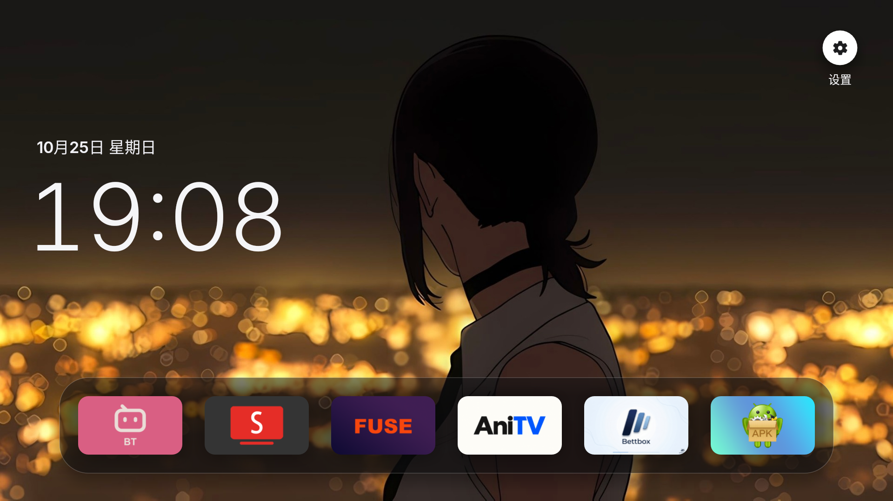

# Free TV · Android 8 中文精简版

一个面向电视遥控器的简洁桌面：时钟、本地壁纸和常用应用。支持 **Android 8.0 及以上**，包含 ARMv7 / armeabi-v7a 电视；APK 不含原生库，为通用架构安装包。

**当前版本：1.4.3** · [下载安装包](https://github.com/Emokui/Free-TV/releases/latest) · [版本记录](https://github.com/Emokui/Free-TV/releases)

本项目基于 [simbasjungles/free-my-tv](https://github.com/simbasjungles/free-my-tv)，是独立的 Android 定制版，不代表上游官方发行。



## 功能

- 简体中文界面，显示时间与日期。
- 常用应用选择、遥控器长按确定键排序、全部应用列表。
- 从电视存储或 U 盘选择 JPG、PNG、WebP 壁纸。导入后保存到应用内部，可以移除 U 盘。
- 浅色、深色和自动主题；自动模式在 18:00–06:00 使用深色。
- 自定义壁纸遮罩：**0%–100%**，左右键每次调整 1%，默认 15%，支持保存、取消和恢复默认。
- 原厂桌面恢复入口，以及桌面反复崩溃时的自动恢复机制。

已移除影视推荐（含 TMDB / Watchmode 请求、海报缓存、推荐卡片与分类导航）、应用屏保、天气与城市、行情、专用遥控器按键映射、直播与 HDMI 快捷入口。桌面无需配置影视 API 密钥。

## 安装与升级

从 [Releases](https://github.com/Emokui/Free-TV/releases/latest) 下载 APK，用电视文件管理器安装，或在电脑上通过 ADB 安装：

```sh
adb connect TV_IP:5555
adb install -r Free-TV-Android8-v7a-zh-Lite-1.4.3.apk
```

将 `TV_IP` 替换为电视的局域网 IP，并在电视上允许 USB/网络调试。

| 已安装版本 | 升级到 1.4.3 |
|---|---|
| 本仓库提供的 1.3、1.3.1、1.4、1.4.1 | 同签名，可覆盖安装，保留设置与壁纸 |
| 本仓库旧版 1.2 及更早版本 | 原签名密钥已丢失，需要卸载旧版，会清除设置、排序和内部壁纸 |
| 上游官方包或自行构建的不同签名版本 | 无法直接覆盖安装 |

需要卸载时，先在旧版设置中恢复“原厂桌面”，并保留壁纸的原始图片，再卸载旧版。首次启用本桌面：打开 Free TV → 桌面 → 启用 Free TV；按提示允许电视自身的 ADB 调试。该操作会切换默认桌面，并停用上游适配名单中的部分应用，可通过“恢复原厂桌面”恢复。

## 遥控器操作

| 操作 | 方式 |
|---|---|
| 进入设置 | 从应用栏按上键，选择右上角齿轮 |
| 进入全部应用 | 从应用栏按下键，选择“全部应用” |
| 调整应用顺序 | 在常用应用上长按确定键，按提示移动与确认 |
| 退出设置 | 遥控器返回键 |

设置中的“电视系统设置”可打开电视原生设置。

## 壁纸、主题与遮罩

1. 打开设置 → **选择本地壁纸**，通过系统图片选择器或文件浏览入口选图。Android 8 首次浏览存储时可能需要授予读取权限。
2. 在 **桌面主题** 中选择浅色、深色或自动。自定义壁纸同样跟随主题。
3. 打开 **壁纸遮罩**，左右键调整百分比，保存后按返回键查看。浅色叠加白色，深色叠加黑色，两种主题共用所选百分比。

0% 保留壁纸原色，100% 完全遮住壁纸；低遮罩比例下，文字可读性取决于图片本身。“恢复 15%”只恢复遮罩，“恢复默认背景”则移除已导入的壁纸。

壁纸在后台缩小、按 EXIF 方向旋转并居中裁剪。遮罩只改变现有绘制层的透明度，不额外解码图片。

## 近期更新

- **1.4.3**：应用更名为 Free TV，仓库更名为 Free-TV；保持包名和签名，可覆盖安装。
- **1.4.2**：彻底移除影视推荐及相关配置；清理推荐导航、动画和图片缓冲，固定显示时钟与本地壁纸。
- **1.4.1**：移植上游应用列表缓存、连续 Home 刷新合并、Android 8–12 玻璃绘制、图标缩小与圆角抗锯齿修复；缓存会在应用、常用应用选择或语言变化后刷新。
- **1.4**：新增可调壁纸遮罩，默认 15%。
- **1.3**：自定义壁纸支持浅色主题；移除“返回桌面”按钮，使用遥控器返回键退出设置。

已在一台海信 Android 8 / ARMv7 / 1080p 电视验证覆盖安装、壁纸和设置保留、设置返回及应用导航，并通过缓存、壁纸采样、旧功能迁移和真实 Android 图形测试。结果仅代表该设备与测试场景，不构成长期稳定性或其他机型兼容性保证。

## 自行构建

需要 JDK 17+、Android SDK build-tools 34.0.0、platform android-34。设置 `JAVA_HOME` 和 `ANDROID_HOME` 后执行：

```sh
bash build.sh
```

输出 `FreeMyTV.apk`。首次构建会生成 `config.properties`，当前只使用语言与 Google Assistant 停用选项；旧配置中的影视推荐相关键会被忽略。

`config.properties` 和 `freemytv.keystore` 不应提交到 GitHub。**请单独备份签名密钥**，后续覆盖更新必须沿用同一密钥。自行构建会使用自己的签名，无法覆盖其他签名的安装包。

## 测试

构建完成后运行不依赖 Android 设备的回归测试：

```sh
mkdir -p out/tests
javac -encoding UTF-8 -cp "out/classes:$ANDROID_HOME/platforms/android-34/android.jar" -d out/tests tests/LiteTest.java
java -cp "out/tests:out/classes:$ANDROID_HOME/platforms/android-34/android.jar" io.freemytv.LiteTest
```

`tests/RenderTest.java` 用于在真实 Android 运行时检查图片缩小与玻璃回退绘制，不能直接通过 SDK stub jar 在电脑上运行。

## 来源与许可

保留上游 [MIT 许可证](LICENSE)。初始基础提交为 `94a55c097c8d199efa6a0fbac298fb02acaa91bf`；1.4.1 选择性移植 `3d38bf2`、`52bdcbe`、`5ad5a09`、`ade05dd`、`e9ffe2b`、`76b8b66`、`a990e02`、`6901adc`、`a70e06b` 中适用于本精简版的修复。第三方字体及图标许可保留在各自资源目录。

本仓库只维护 Android 版本，不包含上游的 webOS / Tizen 实现。
